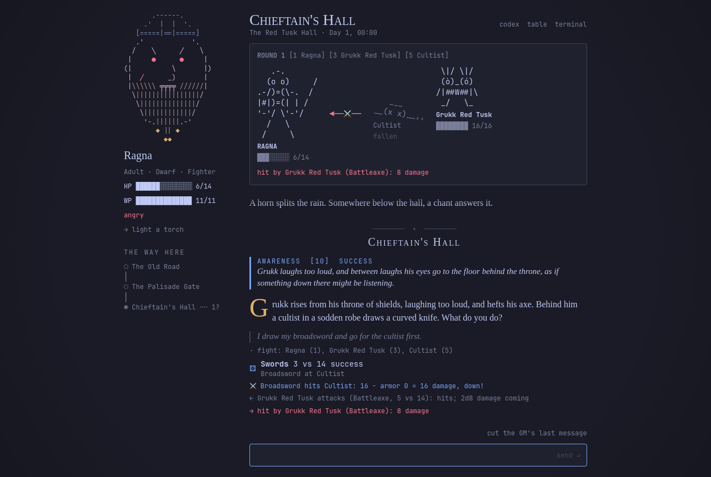

# oma-solorpg

A solo virtual tabletop for [Omarchy](https://omarchy.org). You play a tabletop RPG alone, and your coding agent is the game master.

It is a VTT, not a video game. There are no graphics beyond text: the scene is a page of prose, the map is a list of exits, a fight is drawn in characters, and faces are text portraits. What it gives you is what a VTT gives a table: dice that roll themselves, a character sheet that keeps count, fights with initiative and hit points, clocks and hidden countdowns, an oracle, and a record of everything that happened. The game master is whatever agent Omarchy runs for you (Claude Code, Codex or Pi), headless behind a window called the Book.

- `solo` owns the dice, the rules, character creation and the campaign state. It is standard-library Python (3.11+), with no network access and no API keys. The agent brings the model.
- An omarchy-shell plugin is the table: a d20 in the bar, the Book where the story is told, and a Table docked beside it where you start adventures, make heroes, roll, rest and ask the oracle.
- It plays Ironsworn out of the box: the game's free rules ship in this repository, with credit (see [Ironsworn](#ironsworn) below), so a fresh install plays with no book. It also plays Dragonbane, from your own copy of the books, which aren't in this repository (see [Dragonbane](#dragonbane)); `make dragonbane` builds it from your PDFs.

<p></p>

*The Book in The Red Tusk Hall, the adventure this repository ships: a fight drawn in characters, the hero's sheet and the dice log beside the GM's story.*

> **Generative AI.** The game master is a generative AI: your agent writes the story as you play. Much of this project was also written with an AI coding agent, including its code, the text of The Red Tusk Hall, the hero names and the text-drawn art.

<p></p>

*This game is not affiliated with, sponsored, or endorsed by Fria Ligan AB. This Supplement was created under Fria Ligan AB's Dragonbane Third Party Supplement License.* See [NOTICE.md](NOTICE.md).

*This work is based on Ironsworn, created by Shawn Tomkin, and licensed for our use under the Creative Commons Attribution 4.0 International License (https://creativecommons.org/licenses/by/4.0/). It is not an official Tomkin Press or Ironsworn product.*

## Quick start

You need:

- Omarchy
- `make` and Python 3.11 or newer
- Claude Code (`claude`), Codex (`codex`) or Pi 1.3+ (`pi`), as Omarchy's default agent

```bash
git clone https://github.com/cabral/oma-solorpg ~/Code/oma-solorpg && cd ~/Code/oma-solorpg
git checkout --detach 26048dee18cc6d139fb4281b17f16b4a01faf805   # a fixed commit, so what you read is what you run
make install                                              # links solo, the GM skills and the plugin, and enables it
```

Then click the d20 in the bar, choose New adventure, pick The Bell Under the Hill and Begin. That is Ironsworn, and it needs nothing else: no book, no import.

For Dragonbane, see [Dragonbane](#dragonbane). If something didn't work, `make install` printed what is missing, and [Troubleshooting](#troubleshooting) says what to do.

## Install

`make install` runs `solo setup --plugin`, then `omarchy plugin enable` to switch the plugin on. Setup links three things into your home:

- `~/.local/bin/solo`, the engine's command;
- the GM skills, into the skill folder of each agent you have (Claude Code's, Codex's and pi's; an agent counts as there when its command is on PATH or its own folder is in your home);
- the plugin, as `~/.config/omarchy/plugins/cabral.oma-solorpg`.

It only ever creates symlinks, and never replaces a real file: one in the way is skipped, and the line says so. Running it again is harmless. After the links it prints a short check, a line each for Python, PATH, Omarchy and its shell, `hyprctl` (the desktop effects), your agent and PyMuPDF (only the imports need it), each saying ok or what to do.

The clone is pinned to a commit on purpose. The commit in [Quick start](#quick-start) is the latest release at the time of writing, and `make install` links this folder into your desktop and your agents' skill folders, so what runs is what you checked out and read. To move to a newer one, see [Update](#update).

`make` alone lists every target. `AGENT=codex make rules ...` picks the agent for the targets that use one; the default is Omarchy's default agent.

## Interface scale and settings

Omarchy's global scaling is useful for the whole desktop, but you may prefer to keep your bar and other applications small while making SoloRPG easier to read. SoloRPG can scale independently—or enlarge just the Book without enlarging the Table.

The gear at the top of the Table flips the sidebar over to **Settings**. Use × or Esc to return; the Book, drafts and workspace pin stay in place. GM pace and atmosphere switches now live here too.

- **Book scale** changes only the floating story window.
- **Table & settings scale** changes both faces of the sidebar together, not the Book.
- Both offer **1×, 1.25×, 1.5×, 1.75× and 2×**, applied live and saved across campaigns and restarts.
- The discreet − / scale / + control at the bottom of the Book's hero sidebar changes only the Book. Click the scale value to reset the Book to 1×.

Neither control changes desktop, monitor or bar scaling. Scales are player-owned preferences in `$XDG_STATE_HOME/solo/ui.json` (normally `~/.local/state/solo/ui.json`), not campaign state. They can also be read or changed from the CLI:

```bash
solo ui
solo ui --book-scale=1.5
solo ui --table-scale=1.25
```

**Honor Hyprland settings** under Appearance is opt-in and saved for all campaigns. Both Table faces use Hyprland's resolved outer gaps, rounding, active border (including gradients), and shadow enable/color/range/offset. Values come from `hyprctl` after Lua imports and Omarchy/theme/user overrides, not by parsing `hyprland.lua`. They refresh on enable, Table open and compositor config reload, independently of Table zoom. The Book already receives native Hyprland styling. The Table remains layer-shell: its shadow is a Qt approximation clipped to its surface; window/workspace rules and compositor blur are not copied. If Hyprland is unavailable, shell appearance is used with a notice. Turning the switch off restores shell styling. No desktop configuration is written. Qt 6.9 or newer is required for the shadow component.

`solo ui --honor-hyprland=on` enables it from the CLI; use `off` to restore shell appearance. `solo ui --hyprland-appearance` reads current resolved values without changing preferences.

`solo ui --scale=1.5` explicitly sets both scales for compatibility with the original shared-scale format. Existing `{"scale": N}` preferences initialize both surfaces at N until a scoped choice is saved. To disable the settings flip animation, set `SOLO_REDUCED_MOTION=1` in the shell's environment.

## Update

```bash
cd ~/Code/oma-solorpg
git fetch --tags origin
git log --oneline HEAD..origin/main          # what changed since your commit
git checkout --detach <commit or tag>        # the one the Quick start names now
make install
```

Read what changed before you check it out, for the reason the clone is pinned: [CHANGELOG.md](CHANGELOG.md) says it in words, and `git diff HEAD <commit or tag>` shows it. `make install` again links anything new (a skill, an agent you installed since). Your campaigns and packs in `~/Games/solo` are left as they are.

## Uninstall

`make uninstall` puts back whatever the desktop effects changed (`solo desk restore`), disables the plugin and deletes the symlinks `make install` made (`~/.local/bin/solo`, the plugin link, the GM skills in your agents' skill folders). Nothing else.

These stay, for you to delete if you want them gone:

- `~/Games/solo`: your campaigns, and the packs and adventures you built or imported;
- `~/.local/state/solo`: which campaign is current, the GM's pace and budget, interface scales, and the desktop effects you switched off;
- `~/.cache/solo` and `~/.cache/solo-play`: parsed packs and the sounds, made again when needed.

## Troubleshooting

### PyMuPDF

Only the imports read PDFs (`make dragonbane`, `make rules`, `make supplement`, `make adventure PDF=...`, `solo extract`), and they need PyMuPDF. Playing never does.

On Omarchy, and on Arch in general:

```bash
sudo pacman -S python-pymupdf
```

Arch marks its system Python as externally managed (PEP 668), so `pip install` and `uv pip install --system` refuse to install into it; the package from pacman is the way.

Elsewhere, `python3 -m pip install --user pymupdf`. If pip says the environment is externally managed there too, use a virtual environment, and run the import with it active, since `solo` runs on the first `python3` on PATH:

```bash
python3 -m venv ~/.venvs/solo && ~/.venvs/solo/bin/pip install pymupdf
. ~/.venvs/solo/bin/activate && make dragonbane BOOKS=~/Books/Dragonbane
```

### No agent found

The Book runs Omarchy's default agent headless, and it can drive three: Claude Code (`claude`), Codex (`codex`) and Pi (`pi`, version 1.3 or newer). `solo setup` says which agent it found. If it found none, install one of them and make it Omarchy's default agent (`omarchy default agent`), then run `make install` again so its skill folder gets the GM skills. Another agent still plays, in a terminal: Terminal on the table, or `solo play --terminal`.

### Python too old

`solo` needs Python 3.11 or newer, and says so in a sentence on an older one. It runs on the first `python3` on PATH. Omarchy's is new enough; elsewhere, install a newer Python from your distribution and make sure `python3 --version` shows it.

### The plugin doesn't show

- Run `make install` again and read its lines: the plugin link should say `ok` or `linked`, and the check should find `omarchy` and `omarchy-shell`.
- `~/.config/omarchy/plugins/cabral.oma-solorpg` should point at this folder.
- Enable it by hand with `omarchy plugin enable cabral.oma-solorpg`, and have the shell look again with `omarchy-shell shell rescanPlugins`.

## Play

With clicks only:

1. Click the d20 in the bar. The table opens on the right.
2. New adventure: pick an adventure (The Bell Under the Hill plays Ironsworn with nothing else installed; The Red Tusk Hall plays on the Dragonbane rules you built from your book), then a hero: a pre-made one, or Random, with any kin, profession and age you want to lock in Dragonbane. Reroll until you like the sheet; type a name if you want one. Optionally set the tone and your lines and veils: things that never happen in the story, and things that happen only off screen. The GM reads them every session.
3. Begin adventure. The Book opens beside the table, the scene's name decrypts across the page, and the GM writes the opening.
4. Write to the GM at the bottom of the Book. Its answer streams in as it is written. On the table, click a skill or attribute to roll it (set boons and banes first), push a failed roll, rest, light a torch, or ask the oracle. The GM sees all of it in the log. In Ironsworn the table has moves instead of skills: click a move (and the stat it rolls, and any adds), burn momentum on a roll it could save, start a vow, mark progress on it, and make its progress roll.
5. In Dragonbane, when the GM starts a fight:
   - The Book draws it as a still scene: you, the foes in initiative order, the last blow between you. The table shows your weapons.
   - Pick a foe and click a weapon to attack. When a foe hits you, choose Evade, Parry or Take it.
   - A Dragon on your roll waits for what it does (double the blow, a free attack on another foe, pierce armor) in a card of its own.
   - A hero with spells has them under Magic: set a power level and click a spell that is ready to cast it (the foe you picked takes the damage), prepare another from the Grimoire, or cast it from there.
   - The abilities that go with a blow, a parry, a rest or a new round are switched on first and paid for with the roll. The others are one click, and the GM reads their page.
   - A weapon that is damaged or broken says so on its button. Mend (a roll) and Artisan (none) are in Gear, where the load shows too.
   - At 0 HP you're dying, and Death roll is the only button left.

Right-click the d20 to open the Book again. The Campaigns button lists every game with its hero and scene, so resuming is one click. Delete on a card removes a campaign you've abandoned, folder and all, after a second click to confirm (`solo delete <dir>` from a terminal).

Close the Book whenever you like. The campaign records the conversation word for word, so it opens again exactly where you stopped. `omarchy-shell shell toggle cabral.oma-solorpg` is worth a keybinding.

From a terminal instead:

```bash
solo new red-tusk                                          # random hero, folder under ~/Games/solo/campaigns
solo new red-tusk --character "dwarf fighter" --name Brokk # lock some choices
solo new red-tusk --character ragna --play                 # the pre-made hero, and open the GM
solo new red-tusk --character ~/Games/solo/campaigns/red-tusk-ragna  # a living hero from an earlier campaign, rested
solo character elf mage --seed 7                           # just look at a hero (JSON)
```

## The Book

- Every roll stops the page for a moment: a d20 tumbles, slows and lands. A Dragon glows gold, a Demon shakes red. Rolls you make on the table and rolls the GM makes look the same.
- Your hero's skills speak up. Scenes list what a skill might notice; entering rolls each one quietly, and only a success appears, in the margin, like `SPOT HIDDEN [5] SUCCESS`. You never learn what you missed. The GM can raise one too.
- Your hero's portrait is drawn in text from their kin and profession, and it follows the story: angry, scared, dazed, wounded, dying, dead. A Dragon earns a grin.
- A torch burns down with game time. Dark places are dark.
- The codex (top right) keeps the people you've met, with a face each, and blanks out what they want, fear and hide until you find out.
- Omens from hidden countdowns reach you as omens, never as numbers.
- When your hero dies, the Book closes on a gravestone with your last words, and Home keeps them in the Hall of the Fallen.

Drag across a story passage or Codex entry to select text, then press **Super+C** (Omarchy's default), **Ctrl+C**, **Ctrl+Shift+C** or **Ctrl+Insert** to copy plain text. Double-click selects a word; Shift-click extends the selection. Right-click for **Copy** or **Select passage**: Copy uses the selection, or the whole passage if nothing is selected. **Ctrl+A** selects the current passage; **Esc** clears it. Reading stays read-only. Auto-scrolling pauses during selection or an open Copy menu, and a visible streaming passage holds its displayed words steady while selected; clearing the selection shows the latest text. Selections are per passage and are released when a passage is hidden/recycled or the campaign changes. The composer remains editable.

The GM runs headless: `solo gm turn` drives Claude Code, Codex or Pi one turn at a time and streams what it writes. GM pace, under the table's settings, sets how long it thinks before it answers: Quick answers sooner and spends fewer tokens, Careful thinks longer about the rules. It is the agent's effort level (low, medium or high), one pace for every campaign (`solo gm pace`). Other agents open in a terminal (Terminal on the table, or `solo play --terminal`), and the Book still shows the story as it is recorded.

A GM turn is held in code, not only by the GM's instructions. Claude Code gets two tools, Bash and Read, and Bash may run only the GM's own `solo` commands; a recent Claude Code also runs with `--restricted` and `--permission-mode dontAsk`, so none of your own Claude Code settings or allow rules reach the GM. Codex's sandbox keeps the GM inside the campaign folder, but Codex has no list of allowed commands, so untrusted adventure text is held back less under Codex than under Claude Code.

Pi gets only a `solo` tool that calls this plugin's engine directly with an argument list (and optional stdin), never a shell. Its normal extensions, MCP servers, context files and project configuration are disabled for the Book; the GM skill is supplied explicitly. It uses your Pi model and credentials, streams the reply and resumes a campaign-local session. Pi's reported token usage and cost count toward the same session budget. This is a tool boundary, not an operating-system sandbox.

Every turn has a time limit, and every GM session a spending limit (`solo gm budget`), counted in `~/.local/state/solo`, outside the campaign folder the GM can write. The commands that are yours alone (`solo strike`, `solo prefs`, and setting the budget or the pace) refuse to run inside a GM turn.

### Following your Omarchy theme

The Table follows the shell's complete popup border treatment, including gradients and per-side widths. The Book's links and writing fields follow the shell's normal, hover, focus, pressed, selected and text-selection styles; links are keyboard accessible too. Muted labels and placeholders use the theme's muted color, with a contrast guard for readable text on dark and light surfaces. Error text has its own readable ink without changing the underlying effect colors. The Book keeps its serif prose, and the RPG's fixed gold, border flashes and screen effects stay unchanged.

## The desktop joins in

While a game is on, Omarchy plays along:

- A Dragon flashes your window borders gold and floods the screen with gold light.
- A Demon turns the borders red, drains the colour and tears the picture at its edges.
- A blow jolts the screen. These land when the Book's dice do.
- While your hero is dying, the borders stay dark red and a red rim closes round the screen, further with every failed death roll.
- When they die, the screen goes grey and cold for a while and a bell tolls.
- Omens ripple the screen and arrive as notifications.
- The table has recorded dice that rattle and land in time with the Book, and a quieter recorded page turn when the GM speaks. The CC0 dice recordings are by OldJobobo; the CC0 page turn is credited to Owlish Media (see `assets/sounds/README.md`). The other sounds—a chime for a Dragon, a growl for a Demon, a war drum when a fight starts, a torch catching—are synthesized on the spot the first time they're needed.
- With Candlelight enabled under Desktop effects, the screen warms while the Book is open. It is off by default because it changes the whole desktop's night light. The screensaver shows your hero instead of the logo.
- The bar's d20 lights up when the GM is waiting for you, pulses while you're dying and turns into a skull when you die.

Each of these puts back exactly what it changed (your border colours, your own screen shader, your screen temperature, your screensaver text), and each can be switched off under Desktop effects on the table. If you change the night light while the Book is open, Candlelight leaves your newer choice alone when it closes.

### Recorded sound overrides

Bundled recordings work offline with no conversion tools. Valid mono/stereo integer-PCM WAVs in `$XDG_CONFIG_HOME/solo/sounds` (normally `~/.config/solo/sounds`) override them. `page.wav` replaces the page turn; supply all three of `dice-roll.wav`, `dice-roll-short.wav` and `dice-land.wav` to replace the recorded dice set. The impact plays once from the chosen Book/Table animation's actual landing, not an estimated delay. Mute still applies, and switching campaigns cancels a pending impact.

Recordings must be no longer than 30 seconds or 16 MiB per file, at 8–192 kHz. Invalid overrides are left untouched and ignored. An incomplete local dice set uses the bundled set; if that is unavailable too, the synthesized combined dice sounds remain the fallback. Reload the plugin after changing recordings. Page turns play at 75% volume with PipeWire/PulseAudio; other sounds retain their volume.

### Pin the Table to a workspace

The campaign title wraps below the header controls, leaving Campaigns, the pin and Close room of their own.

The Table normally stays visible across workspaces. Click the outlined pin icon in its header to keep it on its current workspace instead: it hides when you leave and returns when you come back. The Book and a GM turn keep running independently, and focusing another monitor does not hide the Table.

Clicking the bar's d20 from elsewhere brings you back to the pinned workspace. Closing the Table keeps its pin; click the filled pin icon to unpin it and restore the normal behavior. Pins last until the shell/plugin reloads. If Hyprland forgets an empty workspace, the pin is remembered and a bar click brings that workspace back instead of moving the Table elsewhere.

## How a turn works

```
player text
 -> agent picks one intent from what `solo scene` offers
 -> solo check sneaking               dice and rules, in code
 -> agent reads the scene, proposes the consequence
 -> solo commit '{"facts": ...}'      validated, logged, clocks advance
 -> agent narrates what was committed
```

In a game of moves (Ironsworn) the loop is the same and the first step is the move: `solo act face_danger --stat iron` rolls it and comes back with the book's words for the result, and the agent commits what they give or cost (`momentum +1`, `health -1`) and keeps vows and fights as `solo track`s.

Questions nobody rolls for go down a fixed ladder: first the adventure text, then a skill check, then the oracle (`solo ask`), which takes its odds from the tracked state. The agent never picks the answer. The full protocol is in [skills/solo-gm/SKILL.md](skills/solo-gm/SKILL.md).

Without a solo rules book, the oracle is the engine's own: a likelihood oracle that brings its own surprises. Some answers come with a random event tied to the people and threads in play, and entering a scene can find it altered or interrupted, as often as a chaos factor (1 to 9) says. With Dragonbane's solo rules built into your pack, the oracle is the book's own chart (see [Dragonbane](#dragonbane)).

Fights, dying and advancement are rules in the system pack, run by the engine: initiative cards, weapon damage through armor, death rolls at 0 HP, and skills marked by Dragons and Demons and rolled up at the end of a session.

## A long campaign

A campaign can run for many sessions, and the GM may start any of them knowing nothing: the agent's session can be lost, compacted or replaced at any time. The campaign remembers for it.

- What the hero does comes back. The GM writes down what will follow from a deed (the guard who took the bribe will brag, the cultist who fled will warn his master, the debt at the inn falls due in two days), and the engine tells it when the moment comes: the next time you walk into the hall, meet the guard, or when the time has passed. You only see the world react.
- People remember what you did to them, and word spreads to their kin. Someone the GM made up keeps their name, face, voice and wants from one session to the next.
- A place you return to is the place you left: the forced gate still hangs open, and the GM is told how long you were away.
- Before it brings anything back, the GM searches everything ever said at the table (`solo recall`), so a name it gave you three sessions ago stays the same name.
- A fresh session reads the story so far from the log, even if the GM never wrote a recap, and is reminded to write one every dozen messages.
- A hero who lives through an adventure brings their story into the next one (`solo new <adventure> --character <folder>`): how it ended, what was left open, who will remember them, and what you told the GM about them (a lost sister, an oath).

## Ironsworn

Ironsworn is written for solo play, and its moves, oracles and assets are published under a Creative Commons license that lets them ship with this project, with credit ([NOTICE.md](NOTICE.md) has it, and what was changed). `packs/ironsworn` is a whole game, and a fresh install plays it with no book. The starter adventure, The Bell Under the Hill, is this project's own: a hamlet, a road, a barrow and an oath, for one hero and one sitting, with a vow, a journey, a bond and a fight in it.

- The action roll: an action die and a stat (and any adds) against two challenge dice. Beat both for a strong hit, one for a weak hit, neither for a miss; challenge dice that match are a twist. `solo act <move> --stat <stat>`, or click the move on the table. The GM gets the move's own words for the result and decides what it gives or costs.
- Momentum runs from -6 to +10. After a roll it can be burned (`solo burn`, or the button beside the roll): the challenge dice under it are cancelled, and it falls back to its reset. Each impact (wounded, shaken, unprepared and the rest) lowers its ceiling and its reset by one.
- Progress tracks measure vows, journeys, fights and bonds: ten boxes of four ticks, marked by rank and read by a progress roll when the hero ends the challenge (`solo track`). The table draws them as boxes.
- The oracle is a d100 with odds from small chance to almost certain, and a double is a twist; the book's tables for names, places, settlements, turning points and Pay the Price are `solo table`.
- The moves, tables and assets are converted from [Datasworn](https://github.com/rsek/datasworn)'s copy of the rulebook by `solo import datasworn`, each with its page and its credit. The rest of the book's text (its NPCs, atlas and truths) is under a non-commercial license, so it isn't here, and the game doesn't need it.

## Dragonbane

oma-solorpg is a third-party supplement for Dragonbane, published as a virtual tabletop module under Free League's [Dragonbane Third-Party Tabletop Module License](https://freeleaguepublishing.com/community-content/free-tabletop-licenses/). You need the Dragonbane core game to play it. The license lets a supplement use the game's terms and cite its pages, not carry a copy of its rules ([NOTICE.md](NOTICE.md)), so the rules come from your own books.

### Building it from your books

Point `make dragonbane` at a folder of your PDFs. It builds every pack it has an importer for, in about twenty seconds and without an agent. The imports need PyMuPDF; on Omarchy that is `sudo pacman -S python-pymupdf`, and [Troubleshooting](#pymupdf) has the other systems.

```bash
make dragonbane BOOKS=~/Books/Dragonbane                  # a folder of your PDFs (or one PDF)
make check                                                # audits each pack against its book
```

It reads each book's bookmarks and layout, writes your private packs into `~/Games/solo/systems/` and audits every one against the book's own pages:

- The core rules give everything the engine runs (the numbers of every roll and fight, the weapons and armor, all the gear, the tables, character creation, the bestiary, the heroic abilities, the spells), plus a rules page for each section of the book that has words of its own.
- The Book of Magic gives its schools, spells, tricks and recipes.
- The three card decks give the treasure, improvised weapons and adventure hooks.
- The solo booklet gives the fortune chart, the inspiration table, the threat counter and the exploration tables.

The packs are layered. `~/Games/solo/systems/dragonbane-rulebook` holds the core rules, a pack for each further book is laid over it (the Book of Magic, the card decks), and `~/Games/solo/systems/dragonbane` sits on top with the solo rules, each listed under the `extends` of the one above. Campaigns use the top one.

The importers are deterministic: the same PDFs give the same packs, and anything an importer had to decide it says in a note. They hold where things are in a book and how to read them; the words come from your PDF each time, and nothing they write lands in this folder.

The same command builds the adventures into `~/Games/solo/adventures`, and they show up on the New adventure screen:

- the Quickstart: The Sinking Tower, with its seven pre-generated heroes;
- the Adventure Book: its campaign, titled The Secret of the Dragon Emperor, with the opening on the road, the village of Outskirt as the hub, and eleven adventure sites to journey to from it.

Each place of a site is a scene with its read-aloud text and its GM notes, and the ways between them are exits. A door the text calls locked, blocked or hidden is a gated exit the GM opens when the heroes get through. Every person and monster has the stat block the book gives. The build says where it had to choose: a map is a picture, so a way the text doesn't give is linked from the place before it, and said. Clocks and timers are the GM's, as they are in the book.

A book no importer knows (another printing, another adventure) is read by your agent instead: `make rules BOOK=<pdf>` and `make supplement ID=<id> BOOK=<pdf>` start that with the `solo-rules-import` skill, and `make adventure` does it for an adventure with `solo-import`. `make dragonbane` says which of your PDFs it left for them.

If you already have packs an agent wrote from the same books, `solo import book` won't overwrite them. Build the new ones beside them (`--systems ~/Games/solo/new`), and `solo compare ~/Games/solo/new/dragonbane-rulebook ~/Games/solo/systems/dragonbane-rulebook` shows, area by area, what differs, before you decide which to keep.

### What this repository holds

- `packs/dragonbane` holds the game's names (attributes, conditions, skills, what HP and WP are called), a list of hero names per kin, and the text portraits. Its `needs` list says what a campaign can't start without, and the engine refuses to start one on Dragonbane until your own packs supply it.
- The Red Tusk Hall and Ragna are this project's own, written for Dragonbane.
- The tests run on made-up rules (`tests/fixtures/house`) in the same shapes, so they need no book either.

### Playing alone

With the solo rules built, the engine runs Dragonbane alone the way Alone in Deepfall Breach does: a hero with an extra heroic ability, the fortune chart and its inspiration words for the questions a GM would answer, effects for a Dragon or a Demon outside a fight, threats that close in while you delay, searching and scavenging, simple NPCs with attacker roles, healing and rallying alone, and the core set's treasure deck if you type in your cards. On the table these are the oracle's columns, Tend my wounds at a rest, Sole Survivor beside the push buttons, and Rally and Save yourself beside the death roll. `solo rule fortune` (or threats, searching, healing alone) shows each rule as the engine runs it.

## Your own content

Your adventures, your packs and your campaigns live in `~/Games/solo` (set `SOLO_HOME` to move it), outside this folder:

```
~/Games/solo/systems/<id>/      rules packs built from books you own (make dragonbane)
~/Games/solo/adventures/<id>/   adventures you imported or generated; they show up on the New adventure screen
~/Games/solo/sources/<id>/      your books as text, page by page (solo extract)
~/Games/solo/campaigns/<id>/    created by New adventure or solo new
```

An adventure from a PDF you own, or from a Foundry VTT export:

```bash
make adventure ID=my-adventure PDF=~/Books/dragonbane-adventures.pdf
make adventure ID=my-adventure FOUNDRY=~/Exports/my-adventure    # Foundry's Export Data JSON, or fvtt package unpack output
make check-adventure ID=my-adventure
```

From a PDF, `make adventure` extracts the book, starts the pack's inventory and opens your agent with the `solo-import` skill; from Foundry it imports the journals, actors and tables first and asks the agent to add what the text only implies: factions, clocks, gates, branches, NPC profiles and voices. `make check-adventure` validates the pack, prints its outline (spoilers) and audits it against the book. The skill also says how to turn a published adventure's table rules (timers, replacement characters, scoring) into solo ones.

A campaign nobody has written yet, from a premise you pitch:

```bash
make campaign ID=salt-and-ash TONE=grim MISSIONS=4 \
  PREMISE="a smuggler's coast where the dead keep the lighthouses"
make campaign-next CAMPAIGN=~/Games/solo/campaigns/salt-and-ash-ragna   # after each mission
```

`make campaign` rolls the campaign's bones first: a hub to come back to (a safe place), the people who oppose you and a hidden clock for their plan, with omens, and the first mission as a path of three waypoints to its heart. The dice decide what each waypoint holds (a way to get through, someone on the road, a fight, a find, a place that fights back, signs of the enemy), who is there and what they want, from your system pack's own tables where it has them: the solo rules' threats, the treasure deck, the simple NPCs and the bestiary, the inspiration words. Every roll goes into the pack's `rolls.toml`, and what it decided cites it. Then your agent writes the campaign up with the `solo-campaign` skill, keeping to what the dice said, and `make check-adventure ID=salt-and-ash` checks it: it validates, and every roll is used or explained. Until then it's a draft and stays off the New adventure screen.

Missions after the first are written as you play. Once a session closes a mission, `make campaign-next` rolls the next one into the same pack, and rolls which of the things your hero did come back in it: a consequence left open, a promise, someone who remembers you, someone who got away, what word reached a faction. Someone the GM made up in play gets a file of their own, with the name and face you met. The new mission reaches your campaign when the agent has written it; until then the hub tells the GM the next chapter is on its way.

Everything `make` runs is a `solo` command you can run yourself, one step at a time:

```bash
solo extract ~/Books/dragonbane-core.pdf --out ~/Games/solo/sources/dragonbane-rulebook
solo inventory ~/Games/solo/systems/dragonbane-rulebook --extract ~/Games/solo/sources/dragonbane-rulebook
solo import table ~/Games/solo/sources/dragonbane-rulebook/tables/p0045-1.md --out ~/Games/solo/systems/dragonbane-rulebook/tables/fear.toml
solo audit --system ~/Games/solo/systems/dragonbane-rulebook
solo import foundry adventure <export> --out ~/Games/solo/adventures/my-adventure
solo import foundry character <character.json> --out ~/Games/solo/ragna.json
solo validate --adventure my-adventure
solo outline --adventure my-adventure
solo campaign new salt-and-ash --premise "..." --tone grim --missions 4 [--seed 7]
solo campaign roll salt-and-ash treasure --for "what the keeper hides"
solo campaign check salt-and-ash
solo campaign next ~/Games/solo/campaigns/salt-and-ash-ragna
```

How a book becomes a pack, what the formats hold, and what went wrong on earlier imports: [docs/INGESTION.md](docs/INGESTION.md) and [docs/PACK_FORMAT.md](docs/PACK_FORMAT.md). The design is in [docs/PLAN.md](docs/PLAN.md), and what comes next in [ROADMAP.md](ROADMAP.md).

Don't publish packs built from books you bought. They stay in `~/Games/solo`, which is outside this repository for that reason.

## Commands

`solo -C <campaign folder> <command>` runs a command on that campaign; without `-C`, `solo` finds the campaign from the folder you're in, then takes the current one.

| | |
|---|---|
| `solo scene` / `npc <id>` / `rule <topic>` | what the GM reads (Markdown) |
| `solo check <skill> [--boons N --banes N]` / `push [--condition C \| --sole-survivor]` | rolls through the system's resolver (games of skills) |
| `solo act <move> [--stat S] [--add N] [--track ID]` / `burn` | a move's roll, with the book's words for the result; burning momentum on it (games of moves) |
| `solo track add <name> --kind K --rank R` / `mark <id> [--times N]` / `set <id> [--ticks N] [--rank R]` / `end <id> --how H` / `list` | progress tracks: vows, journeys, fights, bonds (games of moves) |
| `solo rest <round\|stretch\|shift> [--heal C] [--tend] [--use A]` | rests from the system pack; time passes |
| `solo journey <km> [--mounted] [--road] [--difficult]` / `camp` | travel a shift at a time until the hero arrives or something needs the GM; finding a place to rest in the wild |
| `solo roll <expr>` / `table <id>` / `ask "<question>" [--kind K] [--likely L \| --npc id \| --meaning]` | dice, tables, the oracle |
| `solo threat add\|random\|advance\|end` / `search` / `scavenge` | threats, searching and scavenging (when the pack has solo rules) |
| `solo fight <npc>... [--join \| --round \| --end]` / `attack [<foe>] --with W` / `enemy [<foe>]` / `ally <npc> [<foe>]` / `defend evade\|parry\|take` | fights |
| `solo dragon double\|attack\|pierce [<foe>]` | what a Dragon on the hero's attack does: double the blow, a free attack on another foe, or pierce armor |
| `solo wound <foe\|hero> <dice\|all> --why W [--through-armor] [--double]` | harm that isn't a weapon blow: fire, spells, traps; `hero` for a fall or a trap on the hero (armor counts) |
| `solo repair <weapon> [--artisan]` | mend a damaged or broken weapon: a roll, or an artisan and none |
| `solo cast <spell> [--power N] [--target F] [--grimoire]` / `prepare <spell> [--drop S]` / `learn <spell> [--from teacher\|grimoire]` | magic: cast a spell the hero knows (its WP paid, its school rolled), hold one ready, learn a new one |
| `solo ability <name> [--cost N]` | pay for a heroic ability the GM runs from its rules page, and log it |
| `solo death-roll [--heal]` / `rally` / `hero <character>` / `mark <skill>` / `advance` | dying (or saving yourself, rallying alone), carrying on after a death, advancement |
| `solo prefs [--tone T] [--line L] [--veil V] [--clear]` | the player's table settings (the GM can't run it without asking) |
| `solo voice <skill> <text>` / `light [torch] [--out]` | a skill speaks up if a quiet roll succeeds; torches burn down |
| `solo move <exit>` / `commit '<json>'` | the only ways the story changes (a commit's `consequence` is a deed that will come back) |
| `solo resume [--book]` / `say [--player] <text>` | where the table stopped; record what was said |
| `solo gm turn [text]` / `gm stop` / `gm status` / `gm agent` | the Book's GM: one headless turn, streamed to `.solo/turn.json` |
| `solo gm pace [quick\|normal\|careful]` | how long the GM thinks before it answers, for every campaign (the GM can't run it) |
| `solo gm budget [dollars] [--turns N] [--reset]` | what one GM session may spend (10 dollars, 200 turns, by default), counted outside the campaign folder; the Book stops with a plain sentence when it is used up (the GM can't run it) |
| `solo strike [--note N] [--line L] [--veil V]` | the X-card, the Book's "cut the GM's last message": it leaves the page and `recall`, and the GM is told not to come back to it (the player's, not the GM's) |
| `solo report [-n N] [--no-messages] [--out F]` | a bug report safe to post: ids, numbers and dice, the GM's commands and the engine and pack versions, with the books' words left out |
| `solo review [--trace F]` | the campaign checked as a play test would: refused commands, bookkeeping in the story, foes that never struck back, consequences never paid, a person with two names |
| `solo ui [--book-scale N] [--table-scale N]` | persistent player-owned scales; Book independently of Table and settings (1×–2×); `--scale N` explicitly sets both |
| `solo desk flash\|dying\|death\|candle\|omen\|screensaver\|sound\|restore\|settings` | desktop effects, always restored |
| `solo recall <words>` / `history` | the GM's long memory: search everything said and written down, or the whole story in order |
| `solo state` / `log` / `rebuild` / `validate` / `outline` | inspection, repair and review |
| `solo new [<adventure>]` / `character` / `library` / `use` / `play [--terminal]` / `delete <dir> [--yes]` | campaigns and heroes |
| `solo setup` / `import` / `extract <pdf>` / `inventory` / `audit` / `compare` | installation and content: a book's PDF as text, a pack built from a book (`import book`), a first inventory, a table from the book, Ironsworn from Datasworn, a pack checked against its inventory and its pages, two packs side by side |
| `solo campaign new\|next\|roll\|check` | a campaign from a premise: roll it, roll its next mission from what the hero did, roll for its author, check it's written and every roll is used |

## Development

Pull requests are welcome: [CONTRIBUTING.md](CONTRIBUTING.md) has the one rule (nothing from a book goes in the repository), how to run the checks, what CI runs on every pull request, and how to write a GM scenario. Report a security problem privately, as [SECURITY.md](SECURITY.md) says.

```bash
make test
```

The mechanics families are `d20-under` (Dragonbane), `d6-pool` (a Year Zero Engine style dice pool, tested with a placeholder pack) and `action-roll` (Ironsworn: an action die and a stat against two challenge dice, momentum and progress tracks). A new game on an existing family is a `system.toml`, not code; its creation tables are a `creation.toml` and its pre-made heroes go in `characters/`. Fights, death rolls and advancement are optional sections of `system.toml` (`[combat]`, `[weapons]`, `[armor]`, `[dying]`, `[advancement]`). Foe attacks by skill roll are d20-under only for now; any family can use monster attack tables.

The tests play on `tests/fixtures/house`, a made-up rules pack laid over the bundled names the way your book's pack is in play. `tests/test_playtest.py` plays The Red Tusk Hall from the road to the end with fixed dice, and `tests/test_long_campaign.py` carries a hero into a second adventure. Ironsworn's rules are in the repository, so its tests play on the pack itself: `tests/test_action_roll.py` covers the engine, and `tests/test_starter_adventure.py` plays The Bell Under the Hill with fixed dice, a vow, a journey, a bond and a fight included.

Whether the GM holds an adventure together is a different question, and `tests/gm_eval` asks it with a real agent, on the rules you built: scenarios play a part of The Red Tusk Hall (or all of it, with a second agent as the player) through `solo gm turn`, check every message and the campaign state in code, and have a third agent judge the transcript. See [tests/gm_eval/README.md](tests/gm_eval/README.md).

```bash
python3 tests/gm_eval/run.py red-tusk-opening   # a few minutes and real model calls
```

The QML can be checked without an Omarchy desktop, with PySide6. To match CI, activate a Python 3.14 virtual environment and run `python -m pip install "PySide6-Essentials==6.11.*"` (see [Running the checks](CONTRIBUTING.md#running-the-checks)). PySide6 is only needed for these offscreen tests, not to run the Omarchy plugin:

```bash
make qml-check                              # Panel.qml and BarWidget.qml loaded with stand-ins for Quickshell, screenshots included
python3 tests/qml/render.py /tmp/book       # the Book, rendered against real engine state, as PNGs
```

The website is in `site/`, plain HTML with no build step: `make site` serves it locally, and `.github/workflows/pages.yml` publishes it to GitHub Pages. [site/README.md](site/README.md) says where the trailers go and where its screenshots come from.

What changed in each release is in [CHANGELOG.md](CHANGELOG.md).

## License

The code and this project's own content (The Red Tusk Hall, The Bell Under the Hill, the hero names, the text portraits) are under the [MIT License](LICENSE). Dragonbane, its terms and the "A Supplement for Dragonbane" logo belong to Fria Ligan AB, and the text in `packs/ironsworn` to Shawn Tomkin; both are used under their licenses, which [NOTICE.md](NOTICE.md) explains.
